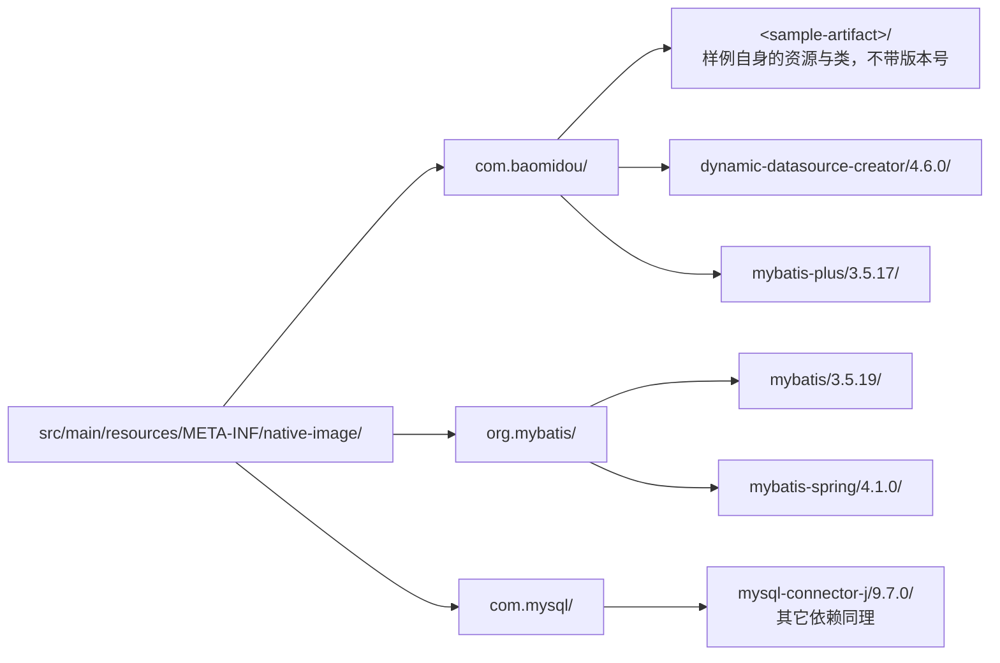

# GraalVM Native Image

`spring-boot-3` 与 `spring-boot-4` 下所有模块都已配置 native image 支持：插件版本由根
`pom.xml` 的 `native-maven-plugin.version` 统一指定，`native` / `nativeTest` profile
由版本线父模块统一管理（未继承 `spring-boot-starter-parent`，故显式定义，语义与官方一致），
子模块声明两个插件即 opt-in：

```shell
# 默认打出可执行 jar（HotSpot 运行）
./mvnw -B -e package -pl spring-boot-4/jdbc-template-sample
# 构建 GraalVM native image（需要 GraalVM，Boot 3 需 22.3+，Boot 4 需 25+；
# 也可用 `spring-boot:build-image` 走 Paketo 构建容器镜像）
./mvnw -B -e -Pnative package -pl spring-boot-4/jdbc-template-sample
# 在 native image 中运行测试
./mvnw -B -e -PnativeTest test -pl spring-boot-4/jdbc-template-sample
```

CI 的 `Native Test CI` 为每个模块单独起一个 job 并行跑 `-PnativeTest test`（清单即
`.github/workflows/ci.yml` 中该 job 的 `matrix.module`；单模块本地跑
`mvn -PnativeTest clean test -pl <module>`）。测试镜像开 quick build（`-Ob`，勿与
`-H:+EnableFallbackCompilation` 同用）。未纳入的只有 `beetlsql-sample`（BeetlSQL 的
AOT 值序列化不支持）与 `tx-seata-sample`（Seata AOT 期要求 Server 可达、且有关闭后
依旧的 null Advisor 问题，见 apache/incubator-seata#8303）。

## Reachability Metadata 的写法

元数据一律以 JSON 写在模块的 `src/main/resources/META-INF/native-image/` 下，按
`<groupId>/<artifactId>/<version>` 分目录（样例自身目录不带版本号），不再使用 Java 的
`RuntimeHintsRegistrar`；只有 AOT 扫描结果驱动的逻辑才留在 Java 中
（如 MyBatis 模板的 `MyBatisBeanFactoryInitializationAotProcessor`）：



两条硬规则：每个条目都带 `condition.typeReached`，键序为 `condition` → `type`/`glob` →
`reason` → 其余属性；条件类必须在该元数据首次被使用之前完成初始化，否则条目会被静默丢弃
（自条件对纯反射加载的类型永远不生效）。各目录的条件类见下表，改动后务必本地跑一遍
对应模块的 `-PnativeTest`。

| 目录 | `condition.typeReached` |
| --- | --- |
| `com.baomidou/dynamic-datasource-creator` | `com.baomidou.dynamic.datasource.creator.DataSourceProperty` |
| `com.baomidou/mybatis-plus` | `com.baomidou.mybatisplus.core.MybatisConfiguration` |
| `org.mybatis/mybatis` | `org.apache.ibatis.session.Configuration` |
| `org.mybatis/mybatis-spring` | `org.mybatis.spring.boot.autoconfigure.MybatisAutoConfiguration` |
| `com.mysql/mysql-connector-j` | `com.mysql.cj.jdbc.Driver` |
| `p6spy/p6spy` | `com.p6spy.engine.spy.P6ModuleManager` |
| `org.springframework.cloud/spring-cloud-consul-core` | `org.springframework.cloud.consul.config.ConsulPropertySources` |
| `org.quartz-scheduler/quartz` | `com.baomidou.dynamic.datasource.creator.DataSourceProperty` |
| `org.apache.shardingsphere/shardingsphere-jdbc` | `org.apache.shardingsphere.driver.ShardingSphereDriver` |
| `com.github.ben-manes.caffeine/caffeine` | `com.github.benmanes.caffeine.cache.Caffeine` |
| `org.apache.seata/seata-all` | `org.apache.seata.spring.annotation.GlobalTransactionScanner` |
| 样例自身（`db/**`、`config*.yaml`、`HelloworldJob` 等） | 触发读取的依赖入口类（`DataSourceProperty`、`DockerClientFactory`、`ShardingSphereDriver` 等） |

`mvn -PnativeTest test` 变红时，按报错补条目即可（GraalVM 报错精确到类/字段）；条件不生效
会被静默丢弃，改条件必跑一遍 nativeTest。常见坑：

- 按路径加载的资源（`db/schema.sql`、`config*.yaml`、`META-INF/services/**` 等）放
  `resources.glob`；`DatasourceInitProperties` 等嵌套绑定类型缺了会导致建表静默跳过；
- `@MapperScan` 显式声明 `sqlSessionFactoryRef`，否则 AOT 丢 `AUTOWIRE_BY_TYPE` 装配；
- `spring-cloud-starter-bootstrap` 与 AOT 不兼容，改用 `spring.config.import`；
- MyBatis mapper 代理与实体由官方 `MyBatisNativeConfiguration` 模板的 AOT 处理器注册，
  bean 名勿与 MP 自带的 `MyBatisPlusNativeImageConfiguration` 重复；Boot 4 模块用的
  mybatis-spring 4.1.0 已内置构造参数修正与 AOT 运行时跳过重复扫描（mybatis/spring#1238、
  #1239），模板因此只剩该处理器；`springboot3-sample` 解析到的 mybatis-spring 3.0.5
  尚无这两处修复，保留完整模板；
- `MySQLContainer` 的挂载问题见 testcontainers-java#7954（子类跳过挂载或用 `GenericContainer`）；
- ShardingSphere 用 `config-native.yaml`（算法与行表达式限制见官方文档），其自带元数据在
  JDBC 用法下多不生效，以本仓库条目为准；另需显式依赖 `javax.transaction-api`，否则
  `XAShardingSphereTransactionManager`（`jakarta.transaction-api` 被 Spring Boot 升到 2.0.1
  后缺 `javax.transaction.*`）会让 GraalVM 构建器崩溃，见 oracle/graal#14717，JVM 下无需该依赖；
- JSON 只保留实测必需（agent 输出是超集，可删；与官方元数据重复的也删，如 caffeine 只留
  官方缺的 `SIMS`；MP 3.5.14 的驱动条目不可删）；flags 按实际访问收紧：实例化留
  `allDeclaredConstructors`，绑定/反序列化再加 `allDeclaredMethods`，MyBatis 的 `MetaObject`
  对（OGNL 调用）只要 `allDeclaredMethods`，caffeine 的 `SIMS` 用 `allDeclaredFields`，
  `SqlSessionTemplate` 用 `allPublicMethods`，只做 `Class.forName` 的只登记类型；
  `allPublicClasses`/`allDeclaredClasses` 不在 schema 里，勿用；
- `beetlsql-sample` 与 `tx-seata-sample` 都卡在 AOT 阶段，元数据尚未被 native 构建读取过：
  seata 按 JVM 测试的 agent 实测裁剪，其余条目对齐其他模块的实测写法，待上游修复后用
  nativeTest 复核；
- 每个条目用 `reason`（字符串数组）记录用途，符合 reachability-metadata-schema-v1.2.0，
  当前 GraalVM 构建报 Unknown attribute 警告但忽略之、实测无影响，见 quarkusio/quarkus#49660。

## 共享库（`polyglot/dynamic-datasource-ffi`）

`polyglot/dynamic-datasource-ffi` 不是 Spring Boot 应用，`native` profile 由 `polyglot/pom.xml` 单独定义：
`sharedLibrary` 构建 `libdynamicds.so`（native-image 的 shared 模式），另加 `-march=compatibility` 与 quick build；
没有 Spring AOT，也没有 `nativeTest`。Rust / Python / TypeScript 三个示例的构建经由 `polyglot/build-libdynamicds.sh`
按需构建共享库，再由它们的集成测试验证（CI 的 `Polyglot CI`）。

- C 入口集中在 `NativeEntryPoints`：isolate 与线程管理用 `@CEntryPoint(builtin = ...)` 重命名为 `dd_*`，
  业务函数统一为 `char* dd_xxx(graal_isolatethread_t*, const char*)`，参数加 `@CConst` 以生成 `const char*`。
- 元数据只依赖 `dynamic-datasource-native-metadata`（boot4 starter 也以 runtime 范围传递依赖它）与 GRM 中
  HikariCP、H2、pgjdbc、Jackson 3 的条目，模块里没有手写的 `reachability-metadata.json`；JSON 只用 Jackson 的树模型，
  不需要为 POJO 登记反射。
- 输出目录会多出 `libawt*.so`、`libfontmanager.so` 等 JDK 库：H2 jar 自带的 `reflect-config.json` 里以
  `org.h2.tools.Server` 为条件的 `java.awt.Desktop` 条目在加入 pgjdbc 后生效，把 AWT 拉进了可达性分析。
  它们在运行时用不上，只需分发 `libdynamicds.so` 与头文件；用 `--exclude-config` 排除 H2 自带的配置可以去掉这些文件，
  但共享库只会小 2 MiB 左右，示例没有这样做。

## 上游 issue 跟进（TODO）

依赖上游修复的待办统一记录在 [upstream-todo.md](./upstream-todo.md)，新增条目请写在那里。
