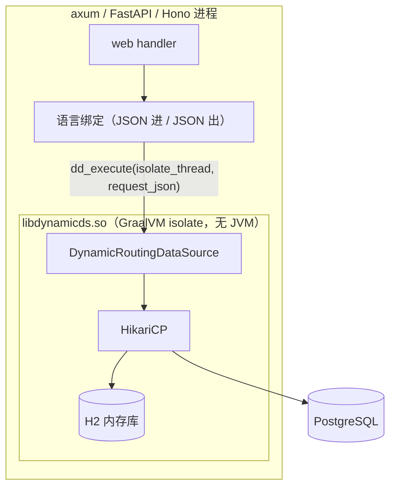

# 在 Rust / TypeScript / Python 中使用 dynamic-datasource

dynamic-datasource 只有 Java 实现。本目录把它构建成 GraalVM native 共享库 `libdynamicds.so`，
再由 Rust、Python、TypeScript 三个 web 示例通过各自语言的 FFI 在**同一进程内**调用：
数据源路由、分组负载均衡、动态增删数据源与多数据源本地事务都由 dynamic-datasource 完成，运行时不需要 JVM。



| 目录 | 说明 |
| --- | --- |
| `dynamic-datasource-ffi` | Java 门面与 C 入口，按 Java 25 编译；`-Pnative` 产出 `libdynamicds.so` 与 `libdynamicds.h` |
| `build-libdynamicds.sh` | 共享库不存在或比 Java 源码、pom 旧时用 GraalVM 构建它；三个示例的构建都调用它 |
| `rust-axum-sample` | Rust 1.88+、axum 0.8、tokio |
| `python-fastapi-sample` | Python 3.11+、FastAPI、ctypes，用 uv 管理 |
| `typescript-hono-sample` | Node.js 26.9+、Hono、内置的 `node:ffi` |
| `Dockerfile`、`compose.yaml` | 本机没有 GraalVM、Rust、Python 或 Node 时的构建、运行与测试方式 |

每个示例的根目录下都有自己的 `config/` 与 `db/`，`dynamic-datasource-ffi` 的单测则放在 `src/test/resources/` 下：
`config/` 是两套数据源配置，`h2.json`（默认，H2 内存库）与 `postgresql.json`；`db/` 是建表与初始数据脚本，
H2 与 PostgreSQL 通用，另有 `db/postgresql/init-databases.sql` 为每个数据源建库。这几份内容目前相同，可以各自修改。

三个示例提供完全相同的 HTTP 接口与测试场景，与仓库里 Java 示例的对应关系：

| 能力 | 对应的 Java 示例 |
| --- | --- |
| 多数据源 + 分组负载均衡（`slave` → `slave_1` / `slave_2`） | `jdbc-template-sample` 的 `@DS("slave")` |
| 按请求头切换数据源 | `spel-sample` 的 `@DS("#header.xxx")` |
| 运行时增删数据源 | `add-remove-datasource-sample` |
| 多数据源本地事务 | `tx-local-sample` 的 `@DSTransactional` |

## 快速开始

### 用 Docker

在仓库根目录执行，三个示例分别监听 8081（Rust）、8082（Python）、8083（TypeScript），各自连一个 PostgreSQL：

```shell
docker compose -f polyglot/compose.yaml up --build
# 改用 H2 内存库
DD_PROFILE=h2 docker compose -f polyglot/compose.yaml up --build
# 只跑测试：镜像构建时做格式检查、lint 与编译，容器运行时跑测试（见下文「测试与检查」）。
# 测试容器经由宿主的 Docker 启动 PostgreSQL，rootless Docker 要加上 DOCKER_SOCKET=$XDG_RUNTIME_DIR/docker.sock
docker compose -f polyglot/compose.yaml run --build --rm rust-test
docker compose -f polyglot/compose.yaml run --build --rm python-test
docker compose -f polyglot/compose.yaml run --build --rm typescript-test
```

示例启动时都会按建表脚本重建表，所以每个示例独占一个 PostgreSQL；测试用的 PostgreSQL 由 Testcontainers 另行启动，
与运行中的服务互不影响。只想构建某一个镜像时，可以直接
`docker build -f polyglot/Dockerfile --target <rust|python|typescript|rust-test|...> .`。

### 在本机运行

需要 GraalVM 25（与 [CONTRIBUTING.md](../CONTRIBUTING.md) 一样推荐 `vfox use java@25.3.4.1-graalce`），并让 `JAVA_HOME`
或 `GRAALVM_HOME` 指向它。进入任意一个示例目录直接运行即可：示例的构建会先调用 `build-libdynamicds.sh`，把共享库构建到
`dynamic-datasource-ffi/target/`（第一次需要几分钟），之后只在 Java 源码或 pom 变化时重新构建。
本机没有 GraalVM 或各语言的工具链时，可以在仓库的 [Dev Container](../CONTRIBUTING.md#dev-container) 里执行下面的命令。

```shell
# Rust：build.rs 构建共享库，并把它所在的目录写进 rpath，不必设置 LD_LIBRARY_PATH
cd polyglot/rust-axum-sample && cargo run
# Python：uv 安装本项目时由 hatch_build.py 构建共享库
cd polyglot/python-fastapi-sample && uv run uvicorn app.main:app --port 8082
# TypeScript：npm 的 prestart / pretest 构建共享库；Node.js 直接运行 .ts，不需要编译
cd polyglot/typescript-hono-sample && npm ci && npm start
```

已经有构建好的 `libdynamicds.so` 时，可以用 `DYNAMIC_DATASOURCE_LIB_DIR`（Rust）/ `DYNAMIC_DATASOURCE_LIB`（Python、
TypeScript）指向它，示例的构建就不再构建共享库，也不需要 GraalVM。

服务默认连 H2。要连 PostgreSQL，先起一个用 `db/postgresql/init-databases.sql` 建好库的 PostgreSQL，再设置
`DD_PROFILE=postgresql`：

```shell
docker run -d --name dd-postgres -e POSTGRES_PASSWORD=postgres -p 5432:5432 \
  -v "$PWD/polyglot/rust-axum-sample/db/postgresql/init-databases.sql:/docker-entrypoint-initdb.d/init-databases.sql:ro" \
  postgres:18.6-trixie
cd polyglot/rust-axum-sample && DD_PROFILE=postgresql cargo run
```

## 测试与检查

三个示例的集成测试是同一组场景（读写分离、分组负载均衡、strict 模式、运行时增删数据源、两种事务、并发请求），
各跑两遍：先用 H2，再用各自语言的 Testcontainers 启动 `postgres:18.6-trixie`，initdb 阶段执行
`db/postgresql/init-databases.sql`，与 `dynamic-datasource-ffi` 的 JVM 单测一致。所以跑测试只需要 Docker，
不必事先准备数据库，也不看 `DD_PROFILE` 与 `POSTGRES_*`。

| 示例 | 测试 | 格式检查与 lint |
| --- | --- | --- |
| `rust-axum-sample` | `cargo test` | `cargo fmt --check`、`cargo clippy --all-targets -- -D warnings` |
| `python-fastapi-sample` | `uv run pytest` | `uv run ruff format --check .`、`uv run ruff check .` |
| `typescript-hono-sample` | `npm test` | `npm run format:check`、`npm run typecheck` |

- rootless Docker 下，Node.js 的 Testcontainers 能自己找到 `$XDG_RUNTIME_DIR/docker.sock`，Rust 与 Python 的
  需要先 `export DOCKER_HOST=unix://$XDG_RUNTIME_DIR/docker.sock`。
- compose 的 test profile 在容器里跑测试：测试容器挂载宿主的 Docker socket，用 host 网络，并经由
  `TESTCONTAINERS_HOST_OVERRIDE=127.0.0.1` 访问 PostgreSQL 的映射端口。rootless Docker 下，容器里连 bridge 网关上的
  映射端口时 TCP 握手能成功，但收不到数据，所以不能用网关地址。Rust 的 testcontainers 不认这个变量，由测试代码自己读取。
- 本目录下的每个文件都带 license 头：源码、`Cargo.toml`、`pyproject.toml`、pom、Dockerfile、compose、SQL 脚本等，
  只有不能写注释的 JSON、Markdown 与工具生成的 lock 文件除外。在仓库根目录用 `./mvnw license:check` 检查、
  `./mvnw license:format` 补齐；新增一种插件不认识的文件类型时检查会直接失败，需要在 `pom.xml` 里登记它的注释风格。
- CI 里，`Lint & Format CI` 做 license 头、格式检查与 lint，不需要 GraalVM 与共享库（`cargo clippy` 只做检查，不链接）；
  `Polyglot CI` 的三个 job 与本地一样，由各示例的构建先构建共享库，再跑测试。

## 代码结构

三个示例按各自框架推荐的方式拆分文件：FastAPI 见
[Bigger Applications](https://fastapi.tiangolo.com/tutorial/bigger-applications/)，Hono 见
[Best Practices](https://hono.dev/docs/guides/best-practices#building-a-larger-application)；axum 没有官方约定，
用的是 Rust 模块与文件一一对应的常见写法。这几个生态习惯按资源组织代码，而不是像 Java 那样按 controller / service /
mapper 分层（Hono 文档还明确不建议写 Rails 式的 Controller），所以资源相关的业务逻辑与它的路由放在同一个模块里，
例如扣库存的函数在 products 模块。

| 职责 | `rust-axum-sample/src` | `python-fastapi-sample/app` | `typescript-hono-sample/src` | Java 中的对应 |
| --- | --- | --- | --- | --- |
| 进程入口 | `main.rs` | `main.py` | `server.ts` | `LocalTxApplication` |
| 组装各资源的路由 | `routes.rs` | `main.py` 的 `create_app` | `app.ts` | 由 Spring 完成 |
| 配置 | `config.rs` | `config.py` | `config.ts` | `application.yml` |
| 错误响应 | `error.rs` | `errors.py` | `errors.ts` | tx-local-sample 的 `GlobalExceptionHandler` |
| `/users` | `routes/users.rs` | `routers/users.py` | `routes/users.ts` | jdbc-template-sample、spel-sample |
| `/datasources` | `routes/datasources.rs` | `routers/datasources.py` | `routes/datasources.ts` | add-remove-datasource-sample |
| `/orders` | `routes/orders.rs` | `routers/orders.py` | `routes/orders.ts` | `OrderController`、`OrderService` |
| `/products`、扣库存 | `routes/products.rs` | `routers/products.py` | `routes/products.ts` | `ProductService` |
| `/accounts`、扣余额 | `routes/accounts.rs` | `routers/accounts.py` | `routes/accounts.ts` | `AccountService` |
| libdynamicds 的封装 | `dynamic_datasource.rs` | `dynamic_datasource.py`，共用的实例在 `database.py` | `dynamic-datasource.ts`、`native.ts`、`worker.ts` | — |

## HTTP 接口

字段名统一使用 snake_case。错误响应为 `{"code","message"}`，三个示例的状态码与 `code` 一致。

| 方法 | 路径 | 说明 |
| --- | --- | --- |
| GET | `/users` | 默认读 `slave` 组；请求头 `X-Datasource` 可指定任意数据源或分组；响应头 `X-Datasource-Served` 回显实际命中的数据源 |
| POST | `/users` | `{"name","age"}`，写 primary（`master`），返回自增 `id` |
| GET | `/datasources` | 当前的数据源与分组：`{"datasources":[...],"groups":{"slave":[...]}}` |
| POST | `/datasources` | `{"name","url","username","password","driver_class_name"}`；名称带下划线时自动入组（`slave_3` → `slave`），建表脚本由服务端指定 |
| DELETE | `/datasources/{name}` | 删除数据源并关闭它的连接池；primary 不能删除 |
| POST | `/orders` | `{"user_id","product_id","amount"}`，用会话式事务下单，流程与 `tx-local-sample` 逐行对应 |
| POST | `/orders/batch` | 同上，改用一次调用完成的批量事务 |
| GET | `/orders`、`/products/{id}`、`/accounts/{id}` | 查看订单、库存与余额 |

| 状态码 | `code` |
| --- | --- |
| 400 | `BAD_REQUEST`（请求不合法，或删除 primary） |
| 404 | `DATASOURCE_NOT_FOUND`（strict 模式下找不到数据源）、`PRODUCT_NOT_FOUND`、`ACCOUNT_NOT_FOUND` |
| 409 | `INSUFFICIENT_STOCK`、`INSUFFICIENT_BALANCE`、`UPDATE_COUNT_MISMATCH`、`CONSTRAINT_VIOLATION` |
| 500 | 其他 |

```shell
curl -i localhost:8081/users                                   # X-Datasource-Served 在 slave_1 与 slave_2 之间轮换
curl -i -H 'X-Datasource: master' localhost:8081/users
curl -H 'Content-Type: application/json' -d '{"name":"李四","age":20}' localhost:8081/users
# H2 下的连接信息；compose 的 PostgreSQL 变体里改成 jdbc:postgresql://rust-postgres:5432/ds_slave_3，用户名与密码都是 postgres
curl -H 'Content-Type: application/json' localhost:8081/datasources \
  -d '{"name":"slave_3","url":"jdbc:h2:mem:ds_slave_3;DB_CLOSE_DELAY=-1","username":"sa","password":"","driver_class_name":"org.h2.Driver"}'
curl -X DELETE localhost:8081/datasources/slave_3
curl -H 'Content-Type: application/json' -d '{"user_id":1,"product_id":1,"amount":1}' localhost:8081/orders
curl -H 'Content-Type: application/json' -d '{"user_id":1,"product_id":1,"amount":6}' localhost:8081/orders/batch   # 409 余额不足
```

初始数据与 `tx-local-sample` 相同：商品单价 10、库存 20，账户余额 50。`master`、`slave_1`、`slave_2` 是三个独立的库，
各自的初始用户带上了库名，这样负载均衡在响应里看得见；真实环境中 slave 是 master 的只读副本。

## 数据源配置

示例自带的 `config/<DD_PROFILE>.json`（默认 `h2`）的字段与 `spring.datasource.dynamic.*` 同名（camelCase），由 `dd_open` 组装成
`DynamicRoutingDataSource`，相当于 Spring Boot starter 的自动配置：

| 字段 | 说明 |
| --- | --- |
| `primary`、`strict` | 同 `spring.datasource.dynamic.primary` / `strict`，默认 `master` / `false` |
| `strategy` | 分组的负载均衡策略：`loadbalance`（默认，轮询）或 `random` |
| `lazy` | 全局懒加载，同 `spring.datasource.dynamic.lazy` |
| `txIdleTimeoutSeconds` | 会话式事务的空闲超时，默认 30 |
| `datasource.<name>` | `url`、`username`、`password`、`driverClassName`、`lazy`、`init.schema`、`init.data`、`init.continueOnError`，以及 `hikari.maxPoolSize` / `minIdle` / `connectionTimeout` |
| `variables` | 占位符的取值，由宿主程序在调用 `dd_open` 前填入 |

字符串值里的 `${NAME}` / `${NAME:default}` 占位符依次取 `variables`、环境变量、默认值。三个示例都把 SQL 脚本目录放进
`variables.DB_DIR`；`postgresql.json` 里的 `${POSTGRES_HOST:localhost}` 等在运行服务时来自环境变量，测试则把
Testcontainers 给出的地址放进 `variables`。共享库内置 H2 与 PostgreSQL 驱动。

## libdynamicds 的 C ABI

构建时生成的 `libdynamicds.h` 声明了下列函数。业务函数的签名统一为
`char* dd_xxx(graal_isolatethread_t* thread, const char* request)`：请求与返回值都是 NUL 结尾的 UTF-8 JSON，
返回值必须交给 `dd_free` 释放。

| 函数 | 说明 |
| --- | --- |
| `dd_create_isolate()` | 创建 isolate，调用线程随之 attach；进程内只需调用一次 |
| `dd_get_isolate(thread)` | 取 isolate 句柄，交给其他线程 attach |
| `dd_attach_thread(isolate)` / `dd_detach_thread(thread)` | 当前 OS 线程 attach（幂等）/ 线程退出前 detach |
| `dd_open` / `dd_close` | 按上面的配置组装 `DynamicRoutingDataSource` / 回滚未结束的会话式事务并关闭所有连接池；关闭后可以再次打开 |
| `dd_execute` | `{"ds","sql","params","generatedKeys","expectUpdateCount"}` → `{"datasource","rows"}` 或 `{"datasource","updateCount","generatedKeys"}` |
| `dd_transaction` | `{"statements":[...]}`，一次调用内的本地事务，语义同 `@DSTransactional` |
| `dd_add_datasource` / `dd_remove_datasource` / `dd_list_datasources` | 对应 `DefaultDataSourceCreator#createDataSource` + `addDataSource`、`removeDataSource`；都返回当前的数据源与分组 |
| `dd_tx_begin` / `dd_tx_execute` / `dd_tx_commit` / `dd_tx_rollback` | 会话式事务，`dd_tx_execute` 的请求在 `dd_execute` 的基础上多一个 `txId` |
| `dd_free(thread, pointer)` | 释放业务函数返回的字符串 |

- `ds` 省略时走 primary；`datasource` 是**实际命中**的数据源，对分组请求就是被负载均衡选中的成员。
- `generatedKeys` 指定要返回的自增列；`expectUpdateCount` 与实际更新行数不符时报错（在事务里则整体回滚）。
- 返回值统一为 `{"ok":true,"data":...}` 或 `{"ok":false,"error":{"code","type","message","sqlState"}}`，
  入口内捕获全部异常，绝不让 Java 异常穿过 C 边界。

| `error.code` | 含义 |
| --- | --- |
| `BAD_REQUEST` | 请求 JSON 不合法、缺少必填字段、占位符无法解析，或删除 primary |
| `NOT_OPEN` / `ALREADY_OPEN` | 还没有 `dd_open` / 重复 `dd_open` |
| `DATASOURCE_NOT_FOUND` | strict 模式下找不到数据源或分组 |
| `UPDATE_COUNT_MISMATCH` | `expectUpdateCount` 不满足 |
| `TRANSACTION_NOT_FOUND` | 会话式事务不存在、已结束或因空闲超时被回滚 |
| `CONSTRAINT_VIOLATION` | 违反数据库约束（SQLState 23xxx） |
| `SQL_ERROR` / `INTERNAL` | 其他 SQL 错误 / 其他错误 |

## 线程模型

GraalVM 要求调用入口的 OS 线程已经 attach 到 isolate；dynamic-datasource 放在 ThreadLocal 里的状态
（`DynamicDataSourceContextHolder`、本地事务）则天然按 attach 后的 Java 线程隔离。三个示例的约定相同：
启动时由一个线程创建 isolate 并 `dd_open`，之后每个工作线程第一次调用时 attach 一次并缓存。

| 语言 | 不阻塞事件循环的方式 | attach 缓存在 | detach |
| --- | --- | --- | --- |
| Rust | `tokio::task::spawn_blocking` | `thread_local!` | blocking 线程退出时由 TLS 析构完成 |
| Python | FastAPI 同步 `def` 路由在线程池执行，ctypes 调用期间释放 GIL | `threading.local` | 线程池线程常驻，不需要 |
| TypeScript | `node:ffi` 只有同步调用，所有调用交给固定大小的 `worker_threads` 池 | 每个 worker 启动时 attach | worker 退出前 |

## 两种事务

- **会话式事务**（`POST /orders`）：`dd_tx_begin` 之后可以跨多次调用执行语句，宿主程序在中途读库存、判断余额，
  与 `tx-local-sample` 的 service 代码逐行对应。三个示例都把它包装成 `transactional`（相当于 `@DSTransactional`：
  正常返回时提交，抛出异常时回滚）。宿主程序的调用可能落在不同线程上，所以 Java 侧为每个事务分配一个专用线程，
  空闲超过 `txIdleTimeoutSeconds` 的事务会被自动回滚，以免忘记收尾时一直占着连接。
- **批量事务**（`POST /orders/batch`）：一次 `dd_transaction` 调用执行一批语句，适合不需要在中途做判断的场景。
  示例用 `CHECK (stock >= 0)`、`CHECK (balance >= 0)` 约束兜底库存与余额，按约束名还原成与会话式事务相同的错误码；
  单价作为扣库存语句的条件，配合 `expectUpdateCount` 实现乐观锁。

## 环境变量

| 变量 | 说明 |
| --- | --- |
| `DD_PROFILE` | 服务启动时选择 `config/<DD_PROFILE>.json`，默认 `h2`；测试不看它 |
| `DD_LOG_LEVEL` | Java 侧（slf4j-simple，输出到 stderr）的日志级别，默认 `info` |
| `POSTGRES_HOST` / `POSTGRES_PORT` / `POSTGRES_USER` / `POSTGRES_PASSWORD` | 服务的 PostgreSQL 变体的连接信息，默认 `localhost` / `5432` / `postgres` / `postgres`；测试改用 Testcontainers 给出的值 |
| `SAMPLE_DIR` | 示例自带的 `config/` 与 `db/` 所在的目录，默认是示例的根目录；Rust 的运行镜像里只有二进制，由 Dockerfile 设置 |
| `DYNAMIC_DATASOURCE_LIB_DIR`（Rust，构建时）/ `DYNAMIC_DATASOURCE_LIB`（Python、TypeScript） | 现成的共享库所在目录 / 共享库路径，设置后示例的构建不再构建共享库；默认构建并使用 `dynamic-datasource-ffi/target` 里的 |
| `PORT` | 监听端口，默认 8081 / 8082 / 8083 |

## 实现要点与限制

- 脱离 Spring 容器手工组装 dynamic-datasource 时要注意两点（见 `DynamicDataSourceFacade`）：
  `HikariDataSourceCreator` 的无参构造会让全局 `HikariCpConfig` 为 null，`ConfigMergeCreator` 合并配置时随即 NPE，
  须传入 `new HikariCpConfig()`（JVM 下同样如此，与 native image 无关，见
  [baomidou/dynamic-datasource#821](https://github.com/baomidou/dynamic-datasource/issues/821)）；手工使用
  `TransactionalTemplate` 时 `TransactionalInfo.rollbackFor` 必须设成 `{Exception.class}`（`@DSTransactional` 的默认值），
  否则抛出异常后事务仍会提交。
- native 元数据只依赖 dynamic-datasource 自带的 `dynamic-datasource-native-metadata` 与 GraalVM Reachability Metadata
  Repository，模块里没有手写的 `reachability-metadata.json`。
- 共享库约 56 MiB，运行时只依赖 glibc 2.34+ 与 libz；构建输出目录里还会出现 `libawt*.so`、`libfontmanager.so` 等 JDK 库，
  运行时用不上，只需分发 `libdynamicds.so` 与头文件（Dockerfile 的 libdynamicds 阶段只导出这两类文件）。
- 构建参数带了 `-march=compatibility`，可以在较老的 x86-64 CPU 上加载；只在 Linux x86_64 上验证过，
  macOS、Windows、arm64 与 musl（Alpine）未验证。
- `node:ffi` 从 Node.js 26.9 起默认开启，但仍是 Stability 1（实验性），API 可能变化；每个 worker 会打印一条
  ExperimentalWarning，示例用 `--disable-warning=ExperimentalWarning` 关掉了它。
- 进程内同一时刻只有一个已打开的 `DynamicRoutingDataSource`。`POST /datasources` 接受任意 JDBC URL，
  与 Java 版 `add-remove-datasource-sample` 一样只用于演示，生产环境必须加鉴权。
